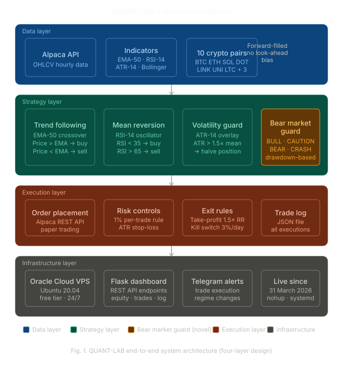

# QUANT·LAB: Adaptive Crypto Trading Bot with Live Dashboard

> 🎓 **MSc project, Ulster University** (Computer Science & Technology, 2026).
> Runs on **Alpaca paper trading only** (virtual money). **Not financial advice.**

## What it does
QUANT·LAB is a Python trading bot that scans 10 crypto pairs every 10 minutes, detects the current market regime (bull, caution, bear, crash) and switches between strategies accordingly. A Flask backend and a web dashboard show portfolio value, trades, equity curve and the live bot log.

## Features
- **Regime-based strategy switching:** trend following, mean reversion and a volatility guard
- **Risk management:** 1% risk per trade, ATR-based stop loss, 1.5:1 reward-to-risk, minimum cash reserve
- **Indicators implemented from scratch:** EMA, RSI, ATR
- **Bracket orders** (stop loss and take profit) placed through the Alpaca API
- **REST API (Flask):** `/api/summary`, `/api/trades`, `/api/equity`, `/api/log`, `/api/strategies`, `/health`
- **Live dashboard:** KPI cards, equity curve, allocation chart and trade table (Chart.js)
- Trade and activity logging to JSON and log files

## Architecture


Data pipeline: [docs/data-pipeline.svg](docs/data-pipeline.svg)

| File | Purpose |
|------|---------|
| `regime_bot.py` | Trading bot: indicators, regime detection, strategies, order execution |
| `server.py` | Flask REST API that reads Alpaca account data and trade logs |
| `dashboard.html` | Front-end dashboard served by the Flask server |
| `start_quantlab.sh` | Starts the bot and the dashboard (reads keys from `.env`) |

## Tech stack
Python 3 · Flask · Flask-CORS · Requests · Alpaca Trading API (paper) · Chart.js · Bash · Ubuntu (Oracle Cloud free tier)

## How to run
```bash
git clone https://github.com/Yawar-hussain/quantlab-crypto-trading-bot.git
cd quantlab-crypto-trading-bot
pip install -r requirements.txt

cp .env.example .env        # then add YOUR OWN Alpaca PAPER keys to .env
bash start_quantlab.sh      # dashboard at http://localhost:5000
```
You need a free [Alpaca](https://alpaca.markets) paper-trading account to get keys.

## Results and limitations
The bot was tested on historical data and on a paper account during my MSc project. Backtests are **not a guarantee of future performance**, and paper trading ignores real-world slippage and fees. Full methodology, results and discussion are in my MSc research report, available on request.

## What I learned
- Building an end-to-end system: data → strategy → execution → API → dashboard
- Risk-first design (position sizing, stop losses, cash reserve) matters more than any single strategy
- Deploying and running a service on a Linux VPS, and keeping secrets out of source control

## What I'd improve next
- Unit tests for indicators and position sizing
- Move configuration into a config file and add a proper backtesting module
- Add authentication to the dashboard API before exposing it publicly

---
*No API keys are stored in this repository. Configuration is read from a local `.env` file, which is git-ignored.*
